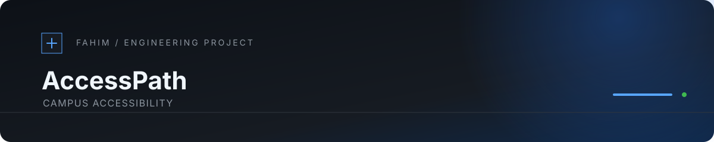

<div align="center">




</div>

<div align="center">

# AccessPath

### Accessible Campus Navigation & Accessibility Operations Platform

**Every student deserves an accessible path.**

[](https://nodejs.org/)
[](https://react.dev/)
[](https://www.typescriptlang.org/)
[](./LICENSE)
[](#project-status)

[Features](#-what-accesspath-does) · [Architecture](#-architecture-at-a-glance) · [Getting Started](#-getting-started) · [Documentation](#-documentation) · [Contributing](./CONTRIBUTING.md)

</div>

---

## Overview

AccessPath is a full-stack campus accessibility platform designed to help students, visitors, volunteers, moderators, and facilities teams understand and improve the accessibility of campus environments.

The platform combines accessible route planning, community barrier reporting, on-site verification workflows, facility-status monitoring, indoor wayfinding, and administrative operations. It is designed around one important rule: **a route must not be presented as accessible unless its required accessibility information is sufficiently verified.**

The application includes a bilingual English/Bangla experience and a synthetic demo campus for local evaluation. It is a software project and does not replace an on-site accessibility assessment, emergency service, or formal legal compliance audit.

## ✨ What AccessPath Does

| Area | Capabilities |
| --- | --- |
| Accessible route planning | Dijkstra and optional A* search, hard accessibility constraints, alternative routes, and safe failure when no verified route is available |
| Accessibility trust and verification | Segment-level freshness states, expiring verification, disputed reports, verification coverage, and human inspection workflows |
| Barrier reporting | Community-submitted accessibility reports, moderation, evidence handling, and follow-up workflows |
| Indoor navigation | Multi-floor building maps, floor transitions, registered QR waypoints, and browser capability checks |
| Facility operations | Elevator, door, restroom, and construction status tracking with operational alerts |
| Class schedule planning | Class-to-class route planning, departure recommendations, and transition warnings |
| Emergency planning | Floor-aware evacuation planning, accessible exits, assembly points, and printable plans with explicit safety limitations |
| Accessibility digital twin | Admin-only what-if simulations on a detached graph copy; simulated changes do not become verified campus facts |
| Operations and analytics | Maintenance metrics, equipment incidents, GeoJSON workflows, request tracing, and readiness monitoring |
| Bilingual and offline experience | English/Bangla localization, PWA support, offline draft handling, and deterministic AI mock mode |

### Trust-first routing

AccessPath applies accessibility requirements as route constraints rather than treating them as optional preferences. Depending on the route request and available campus data, the engine can account for blocked paths, stairs, facility outages, unverified segments, slopes, and clearance requirements.

When the system cannot establish a suitable verified route, it can return a safe no-route result instead of inventing an accessible path. Route confidence and freshness indicators are decision-support signals, not physical accessibility certifications.

### AI with human oversight

The project includes a server-side Google Gemini integration and a deterministic mock provider for development. AI output is an assistive interface, not an authority: it does not independently verify a building, certify a route, or replace a human inspection.

## 🧱 Technology Stack

| Layer | Technologies |
| --- | --- |
| Frontend | React 19, TypeScript, Vite, React Router, TanStack Query |
| UI and visualization | Tailwind CSS, Lucide, Recharts, Leaflet, Three.js |
| Backend | Node.js 22+, Express, TypeScript |
| Data | MongoDB/Mongoose; local JSON persistence for supported development mode |
| Validation and security | Zod, Helmet, rate limiting, bcrypt, JWT, CSRF and Origin checks |
| Localization | i18next and react-i18next |
| AI | Google GenAI SDK with configurable mock fallback |
| Testing | Vitest, Testing Library, Supertest, Playwright, axe-core |
| Tooling and delivery | Docker Compose, Prettier, Lighthouse CI, GitHub Actions |

Versions and scripts are defined in [package.json](./package.json).

## 🏛 Architecture at a Glance

The repository is organized as a combined full-stack application:

```text
AccessPath-Full-Stack/
├── backend/          # Express API, auth, routing, trust engine and services
├── frontend/         # React application, pages, components and client services
├── shared/           # Shared TypeScript contracts
├── src/              # Vite browser entry point
├── docs/             # Architecture, API, security and operational documentation
├── e2e/              # Playwright end-to-end tests
├── scripts/          # Seed, checks and offline smoke tests
├── public/           # Static assets and PWA resources
├── .github/          # CI and repository workflows
├── server.ts         # Combined development/production server entry point
├── package.json
└── README.md
```

For more detail, see [PROJECT-STRUCTURE.md](./PROJECT-STRUCTURE.md) and [docs/architecture.md](./docs/architecture.md).

## 🚀 Getting Started

### Prerequisites

- Node.js **22 or newer**
- npm (or Bun, if you prefer the included `bun.lock`)
- MongoDB is optional for local development; production configuration requires MongoDB
- A Gemini API key is optional when using the mock AI provider

### 1. Clone the repository

```bash
git clone https://github.com/fahim1252375-maker/AccessPath-Full-Stack.git
cd AccessPath-Full-Stack
```

### 2. Install dependencies

```bash
npm install
```

### 3. Configure environment variables

```bash
cp .env.example .env
```

For a local run without an AI key, set the following values in `.env`:

```dotenv
AI_PROVIDER="mock"
APP_URL="http://localhost:3000"
PORT="3000"
ALLOW_DEMO_SEED="true"
```

You can leave `MONGODB_URI` empty for the supported local JSON development store. To use MongoDB locally, provide a valid connection string. For live Gemini features, configure `GEMINI_API_KEY` and select the Gemini provider.

**Never commit your real `.env` file, API keys, database credentials, or production secrets.** The repository ignores `.env*` files other than the safe `.env.example` template.

### 4. Start the development server

```bash
npm run dev
```

Open [http://localhost:3000](http://localhost:3000).

### 5. Build for production

```bash
npm run build
npm run budget
```

Production startup requires a valid MongoDB connection and a strong `JWT_SECRET` (at least 32 characters):

```bash
NODE_ENV=production \
MONGODB_URI="your-mongodb-connection-string" \
JWT_SECRET="your-long-random-secret" \
npm start
```

Do not use example credentials or demo secrets in a production deployment. Review [the deployment guide](./docs/deployment.md) before exposing an instance publicly.

### Docker Compose

```bash
cp .env.example .env
# Set a unique JWT_SECRET and review the remaining environment values.
docker compose up --build
```

## 🧪 Tests and Quality Checks

The project defines the following commands:

| Command | Purpose |
| --- | --- |
| `npm test` | Run Vitest unit and integration tests |
| `npm run test:simulation` | Run the offline Node smoke-test suite |
| `npm run lint` | Run TypeScript checking |
| `npm run typecheck` | Alias for TypeScript checking |
| `npm run format:check` | Check formatting with Prettier |
| `npm run build` | Build the production frontend bundle |
| `npm run test:e2e` | Run Playwright browser tests |
| `npm run budget` | Check configured bundle-size budgets |
| `npm run audit` | Run npm dependency vulnerability audit |
| `npm run lighthouse:ci` | Run configured Lighthouse CI checks |

Run the checks relevant to your change before opening a pull request. Some checks require installed dependencies, browser binaries, network access, or configured services.

### Verification transparency

A command being defined does not mean it has passed in every environment. The project delivery notes record which checks were executed and which were blocked by dependency/network availability. See [docs/testing.md](./docs/testing.md) and [docs/audit-phase4.md](./docs/audit-phase4.md) for the documented verification status. Please do not interpret a configured test suite as a passing test report.

## 🗂 Documentation

| Document | Description |
| --- | --- |
| [Feature Registry](./FEATURE_REGISTRY.md) | Detailed feature inventory and status records |
| [Architecture](./docs/architecture.md) | System components, boundaries, and design |
| [API Reference](./docs/api-reference.md) | REST API endpoints |
| [Database Schema](./docs/database-schema.md) | Data models, collections, and indexes |
| [Routing Algorithm](./docs/routing-algorithm.md) | Route filtering, trust weighting, Dijkstra, and A* |
| [Accessibility Methodology](./docs/accessibility-methodology.md) | Inclusive design and verification principles |
| [AI Disclosure](./docs/ai-disclosure.md) | AI provider behavior, limitations, and human oversight |
| [Privacy Policy](./docs/privacy-policy.md) | Data handling and privacy considerations |
| [Threat Model](./docs/threat-model.md) | Security threats and mitigations |
| [Deployment Guide](./docs/deployment.md) | Environment and deployment configuration |
| [Testing Guide](./docs/testing.md) | Test strategy and quality commands |
| [Phase 4 Audit](./docs/audit-phase4.md) | Delivery evidence and verification limitations |
| [Project Structure](./PROJECT-STRUCTURE.md) | Repository layout and entry points |
| [Changelog](./CHANGELOG.md) | Project change history |

## 🔐 Security and Privacy

Security-sensitive functionality documented in the codebase includes session revocation, password-reset token handling, CSRF and Origin validation, input allowlists, rate limiting, image metadata handling, and production startup safeguards.

This summary is not a security certification. Review the [threat model](./docs/threat-model.md) and [privacy policy](./docs/privacy-policy.md), and report suspected vulnerabilities privately according to [SECURITY.md](./SECURITY.md).

## ⚠️ Scope and Known Limitations

- Live elevator/BMS telemetry, institutional SSO, SMTP delivery, and external maintenance-system integrations require institution-specific credentials and integration work.
- QR scanning, Bluetooth beacons, and WebXR experiences depend on supported devices, browser permissions, and physical campus infrastructure.
- Demo campus content is synthetic and must not be treated as real-world campus data.
- Route and building indicators depend on the accuracy and freshness of submitted and verified data.
- Emergency plans are informational planning tools; they are not emergency dispatch, official evacuation authorization, or a substitute for local emergency procedures.
- The project does not claim ADA/DDA compliance, WCAG certification, or formal accessibility certification.

## 🤝 Contributing

Contributions, bug reports, documentation improvements, and accessibility feedback are welcome. Please read [CONTRIBUTING.md](./CONTRIBUTING.md) before submitting a change. By participating, you agree to follow the [Code of Conduct](./CODE_OF_CONDUCT.md).

## 📄 License

Distributed under the MIT License. See [LICENSE](./LICENSE) for details.

---

<div align="center">

**AccessPath — Every Student Deserves an Accessible Path.**

Built to make campus accessibility information more transparent, verifiable, and actionable.

</div>
